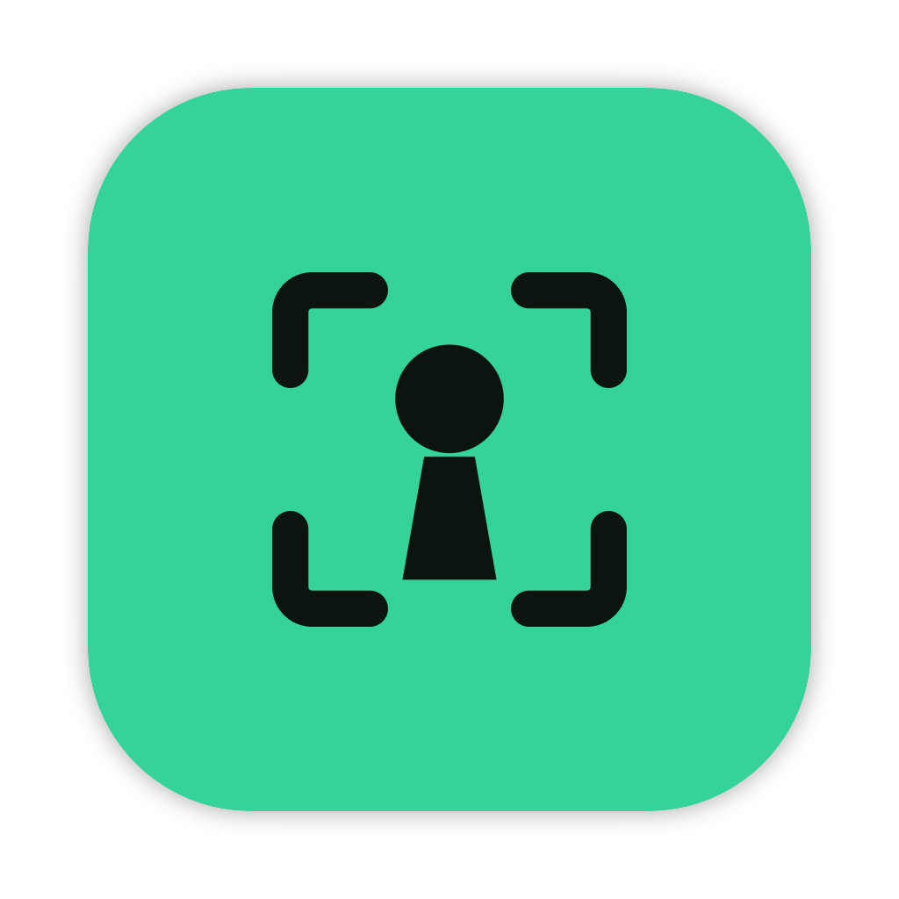

<h1 align="center">
  <br>
  <a href="https://github.com/fparrav/facekey"></a>
  <br>
  Facekey
  <br>
</h1>

<h3 align="center">Face unlock for your Mac</h3>

<p align="center"><b>🇺🇸 English</b> | <a href="README.es.md">🇪🇸 Español</a></p>

<p align="center"><sub>A fork of <a href="https://github.com/jonnyoo/glance">jonnyoo/glance</a>, developed at its own pace.</sub></p>

<p align="center">
  <a href="LICENSE"></a>
  
  
</p>

Facekey brings the FaceID-like experience of your iPhone to a Mac near you. Unlock your Mac with a glance — no typing, no reaching for the TouchID key. Everything runs on-device using Apple's Vision
and Core ML frameworks, so your face data and your Mac password never touch the internet. The UI is built into your Macbook's notch with fluid dynamic island like animations.

> [!NOTE]
> **This is a personal fork.** Facekey exists so I can follow my own development pace and add the features I wish glance had. It is not a replacement for the original, it does not track upstream on a schedule, and I merge upstream changes only when I want them. Everything that works here started as [Jonathan Zhou's](https://github.com/jonnyoo) work. See [How this fork differs from glance](#how-this-fork-differs-from-glance) for what I added or changed.


https://github.com/user-attachments/assets/1e0c1c91-3991-4224-8fd7-318a6127ef7e


---

> [!WARNING]
> ## Read before downloading
> ## Facekey is not as secure as Apple's FaceID or TouchID
> 
> MacBooks don't come equipped with the depth sensors that make iPhone FaceID trustworthy and secure. An
> iPhone builds a 3D map of your face; a MacBook webcam sees a flat 2D image. That means:
> 
> - Facekey defeats, with reasonable confidence, a printed photo and a photo on a phone screen (heavy liveness detection must be turned on)
> - Facekey does not reliably defeat a video of you
> - macOS has no API that lets a third-party app authorize a login, so Facekey unlocks by typing
>   your stored password on the lock screen
> 
> Facekey is a convenience feature, not a security upgrade. Only continue if you accept the tradeoff.

## Installation

**Requirements:**
- macOS 15 Sequoia or later
- Apple Silicon or Intel Mac

<a href="https://github.com/fparrav/facekey/releases/latest/download/Facekey.dmg" target="_self"></a>

Open the `.dmg` file and drag Facekey to `/Applications`, then open it.


## Permissions

| Permission | Why |
|---|---|
| **Camera** | To see your face. Frames are processed in memory and never written to disk. |
| **Accessibility** | To type your password into the lock screen. |
| **Touch ID** | Gates the key that encrypts your face data and password. |

## How it works

1. Launch the app and follow the onboarding to enroll your face. Facekey guides you through capturing your face, turning your head in nine
   directions. Each frame becomes a 512-number *embedding* — a mathematical fingerprint — and the
   image is thrown away.
2. Enter your Mac password once, encrypted behind Touch ID.
3. When your Mac locks or wakes from sleep, the animation appears in the notch and starts searching for a face.
4. If it's you — and the liveness checks agree you're a real person — Facekey types the
   password and you're in.

## Features

| Feature | Description |
|---|---|
| **Face unlock** | Triggers on wake, on lock, or on pressing space at the lock screen. Pick any combination. |
| **Multiple identities** | Enroll several people, or several versions of yourself — with glasses, a beard, different lighting. Toggle any of them off without deleting. |
| **Liveness checks** | Watches for the motion and reflections that separate a real face from a photo. *Light* or *Heavy* strictness, or off. |
| **Notch UI** | A closed pill that expands into a scan animation with success and failure states. Hover to retry — or turn animations off entirely and Facekey stays invisible. |
| **Accent colour** | Pick green, lime, mint, blue or amber in Settings → App. The notch, the scan animations, the pill, the sidebar and the buttons follow it, and the green app icon is the default. |
| **Status text in the notch** | A short line under the scan says what is happening: looking for your face, unlocked, face not recognised, camera unavailable, or approving `sudo`. A small animated mark leads the text: a turning arc while it works, a ring that closes into a check or a cross, a soft amber alert. It never shows when animations are off. |
| **Camera & display** | Choose which camera to use, including different cameras for the built-in display vs. an external monitor. |
| **Auto-locking sessions** | The Touch ID session re-locks itself after an idle period you choose, so an unattended Mac doesn't stay authorized forever. |
| **Verify after other unlocks** | Optional, off by default. After something other than Facekey unlocks the Mac, such as an Apple Watch, a short scan checks who is at the screen and locks it again if it sees a face that isn't enrolled. It runs after the unlock, so it cannot stop the Apple Watch unlock, and an empty room leaves the Mac unlocked. |
| **Sudo approval** | Optional, off by default. When `sudo` asks for a password in a terminal, Facekey shows an Accept / Cancel overlay in the notch, checks your face and approves it, per display setup and per app. Weaker than Touch ID, so read [Sudo approval](#sudo-approval) first. |
| **Unlock Passwords** | Optional, off by default. When Apple's Passwords app is in front and locked, Facekey shows an Accept / Cancel overlay in the notch, checks your face and types your Mac password into its unlock field, per display setup. Weaker than Touch ID, so read [Unlock Passwords](#unlock-passwords) first. |
| **Trackpad haptics** | Hovering over the notch will trigger haptics |
| **Notchless Mac support** | Macs without a notch will be replaced with a pill-shape, dynamic island style design. |
| **Your data, your call** | Edit or delete your enrolment or stored password at any time. The encrypted files are removed immediately. |

## How this fork differs from glance

Glance is a polished, focused app. This fork keeps its idea, architecture and most of its code, and adds the things I wanted for my own daily use. Anything not listed here behaves as in the original.

### Added

| Addition | What it does |
|---|---|
| **Verify after other unlocks** | Optional, off by default. After an unlock by an Apple Watch, Touch ID or a typed password, a short scan looks at who is at the screen and locks the Mac again if an unrecognised face stays in view for 2 seconds. See [Unlocks by other methods](#unlocks-by-other-methods). |
| **Sudo approval** | Optional, off by default. A PAM module ahead of Touch ID in `sudo_local` asks Facekey to approve `sudo` with an overlay in the notch and a face scan, with an allow / block list of apps and an audit log. See [Sudo approval](#sudo-approval). |
| **Unlock Passwords** | Optional, off by default. Detects the Passwords app locked and in front through Accessibility, asks for an Accept click, scans your face and types the stored Mac password only into Passwords. See [Unlock Passwords](#unlock-passwords). |
| **Facekey identity** | A new app icon and menu bar mark, an accent colour you can change, and a vector mark used in About and onboarding. |
| **Status text in the notch** | One line under the scan for each state, including an amber *Camera unavailable* when the camera cannot be opened on the lock screen. The failure line mentions hovering to retry only when that setting is on. |
| **Calibrated detection distance** | The detection distance is a six-stop slider kept separately for each display setup (built-in, built-in + external, external), and a guided **Calibrate** sheet measures your face width through that setup's own camera. |
| **Behaviour per display setup** | Face unlock can be switched on or off for *Built-in only*, *Built-in + external* and *External only*, each with its own camera. The unlock re-checks when displays change while locked, and falls back to the notch screen if a pinned external display's ID goes stale after sleep. |
| **Unlock the session at launch** | Optional. Facekey unlocks its own session when it starts, with no Touch ID prompt. This trades the Touch ID gate on the stored password for convenience. Leave it off if you do not want that. |
| **Permissions page** | Settings shows whether Accessibility and Camera are still granted, says what stops working without each one, and opens the right System Settings pane. Re-signing the app can silently drop Accessibility, and this makes that visible. |
| **Wake-scan pause** | After a scan started by a wake signal finds nobody, further wake signals do not turn the camera on again for 10 minutes. Locking again, unlocking, hovering the notch or pressing space ends the pause. |
| **Quit control in onboarding** | The first-run flow shows a close button on every step except enrollment and completion, so you can leave it without a hidden shortcut. |
| **Scan diagnostics** | Each scan logs what triggered it, the face width, the similarity and the liveness readings, and the logs persist, which is how most of the fixes below were found. |
| **Offline self-tests** | `tools/` gains standalone self-tests for the verification logic and the distance calibration, plus a probe that checks the re-lock shortcut works on your macOS version. |

### Changed

| Change | What it does |
|---|---|
| **Steadier recognition** | A scan compares a rolling average of recent frames instead of a single frame, skips the first dark frames of the camera, and needs a few consistent frames before it decides. Each frame must also clear a floor on its own, so a stranger stepping in cannot ride on the average of the owner's earlier frames. The default scan window is longer, and a sustained non-match takes longer to give up. |
| **Add Captures, not Recapture** | Adding captures to an identity appends them instead of discarding the earlier ones. The per-identity sample cap is 72, and the lowest-quality samples are dropped first. The completion step reports how many were kept. |
| **Easier enrollment poses** | The upper diagonal head poses were hard to hit, so the yaw and pitch thresholds are more forgiving, and stalled poses widen their tolerance sooner. |
| **Liveness false denials** | The glare cue no longer fires on an overexposed live face, and a background edge that clips the face box no longer triggers the device cue. Photo and screen detection otherwise work as before. |
| **Settings in five pages** | The tab bar is now a sidebar with Summary, Access, Security, Camera and displays, and App. Summary shows a *ready to unlock* checklist and links each missing step to its page. The old rows are all still there, regrouped. |

### Renamed and re-pointed

- The app, project, bundle identifiers and Keychain service are `Facekey` and `com.fparrav.facekey`.
- On first launch Facekey copies your glance Keychain items, face store and preferences over, so nothing has to be enrolled again.
- The upstream Sparkle update feed and signing key are removed, and the update controls stay hidden until this fork has a feed of its own. Download and feedback links point to this repository.
- The signing team lives in an untracked `Local.xcconfig`, so it never lands in a commit.

### Not changed

The recognition model (ArcFace through Core ML), the liveness cues, the encrypted storage of face data and password, the way the password is typed on the lock screen, and the notch UI all come from glance.

---

# Privacy and Security

Facekey is designed to keep biometric data and credentials on-device.

### Face data

Facekey never stores camera images. During enrollment, each captured face is converted into a **512-dimensional embedding** using an ArcFace-based Core ML model. The original frame is then discarded.

Embeddings are stored locally and encrypted with **AES-GCM**.

### Credentials

Your Mac password is stored as encrypted data and is never written to disk in plaintext. The encryption key is a **256-bit AES key stored in the macOS Keychain**, protected by `userPresence` — requiring Touch ID or your device password.

The key is only held in memory while an authorized Facekey session is active.

### Unlock pipeline

Facekey won't type your password simply because a face matches. An unlock requires all of the following:

1. A valid Facekey session is authorized.
2. The Mac is actually at the lock screen.
3. An enabled identity matches above the configured similarity threshold.
4. Liveness checks accept the detected face.
5. Accessibility permission is available to enter the password.

Face recognition and liveness detection run independently and must both succeed before the password is entered. 

### Unlocks by other methods

macOS does not let an app approve or block an unlock by an Apple Watch, Touch ID or a typed password, so Facekey cannot gate them. With *Verify my face after other unlock methods* on (Settings → Security), Facekey looks at the screen for up to 6 seconds after such an unlock. A match with any enabled identity ends the check quietly. An unrecognised face that stays in view for 2 seconds locks the screen again. If nobody is in view, nothing happens. After a re-lock the check pauses for 2 minutes so it cannot lock you out in a loop. This is a safety net after the fact, not a gate.

### Sudo approval

Optional, off by default, and installed from **Settings → Security**, which asks for your administrator password. A small PAM module, `pam_facekey.so`, goes ahead of `pam_tid.so` in `/etc/pam.d/sudo_local`. When `sudo` asks for a password in a terminal, the module asks the running Facekey. Facekey shows an overlay in the notch with **Accept** and **Cancel**, and approves only after you accept and your face matches. Every other outcome (Cancel, a timeout, a blocked app, a locked session, Facekey not running, no terminal) falls through to the normal `sudo` prompt, so this only adds a way in for the cases you switch on and never removes one.

**Requirements**

- macOS 15 or later, with Facekey running, at least one enrolled face and the Camera permission.
- An unlocked Facekey session. While it is locked, requests fall through to the normal prompt.
- A Facekey build signed with a developer team. The module is compiled with that team ID and ignores every request without one, so an ad-hoc signed build cannot use this feature.
- Your administrator password, once, to install or remove it. It needs no extra permission such as Full Disk Access or Accessibility.
- `sudo` run by you in a terminal. It never acts for root, over SSH, or when a program feeds the password with `sudo -S` or `-A`.
- The feature switched on for your current display setup in Settings → Security.

**Risks**

- **It is weaker than Touch ID.** A face match is a softer proof than a fingerprint, and a MacBook camera sees a flat image (see the warning at the top). Anyone who can get past the face check and click Accept gets root through `sudo`.
- **It is a gate to root.** The overlay only answers a hardware click, so a script that posts a click counts as Cancel, but someone sitting at your unlocked Mac can still use it.
- **It changes a system file and loads code into `sudo`.** `pam_facekey.so` runs as root inside every `sudo`, and the installer edits `/etc/pam.d/sudo_local`. The module trusts only a Facekey signed by the same team, and it fails open: on any error it does nothing and `sudo` asks for its password. The installer copies its files to a private folder and checks the signature before running them as root, but a process of your own user could still try to swap them in that short window.
- **A macOS update can remove the entry.** `sudo` then goes back to Touch ID or the password, and Settings → Security offers a repair.
- **The history can hold secrets.** Commands are stored with their arguments unless you turn on *Keep only the program name*. The file is encrypted with a key in your Keychain.

**What to know before turning it on**

- **Apps are listed.** The first time an app asks, Facekey asks whether to allow it, and recognises it by its code signature (or, for an unsigned app, by its code). A blocked app is refused outright. The list lives in Settings → Security.
- **The overlay is always visible.** There is no silent approval, and the module only talks to a Facekey signed by the same team.
- **There is an audit log.** Settings → Security shows when each request happened, which app asked, the command and how it ended. It is encrypted and can be cleared, and *Keep only the program name* leaves arguments out.
- **Per display setup.** It can be switched on or off for *Built-in*, *Built-in + external* and *External* displays.
- **It can be removed.** Remove puts `sudo_local` back exactly as it was. A macOS update can drop the entry, and Settings then offers a repair.

### Unlock Passwords

Optional, off by default, and switched on per display setup in **Settings → Security**. When the Passwords app is in front and shows its lock screen, Facekey shows an overlay in the notch with **Accept** and **Cancel**. Only after you click Accept does it scan your face. If an enabled identity matches and the liveness checks pass, it types your stored Mac password into the Passwords unlock field and presses Return. If Passwords is offering Touch ID or an Apple Watch and shows a "Use Password…" button instead of the field, Facekey presses that one button first, and only after the face matched. Every other outcome (Cancel, a timeout, no match, Passwords no longer in front, a locked session, a missing permission) leaves Passwords locked, and you unlock it with Touch ID or your password as usual.

**Requirements**

- macOS 15 or later, with Facekey running, at least one enrolled face, a stored Mac password and the Camera permission.
- The Accessibility permission, which lets Facekey see that Passwords is locked and type into it. Settings → Security warns when it is missing.
- An unlocked Facekey session. While it is locked, nothing is offered.
- The feature switched on for your current display setup in Settings → Security.

**Risks**

- **It is weaker than Touch ID.** A face match is a softer proof than a fingerprint, and a MacBook camera sees a flat image (see the warning at the top). Anyone who gets past the face check and clicks Accept can open everything in the Passwords app: every password, passkey and code.
- **It types your Mac password.** The password is read only at the last moment, after the face matches and only while Passwords is still in front with its unlock field focused, and it is cleared from memory right after typing. If Passwords is not in front, nothing is read or typed.
- **It relies on Passwords' current screen.** A macOS update can change that window, and then Facekey simply shows nothing.

**What to know before turning it on**

- **Never automatic.** Opening, activating or locking Passwords does nothing by itself. Every unlock needs a fresh Accept click, and a click posted by a program counts as Cancel.
- **One attempt per lock.** If Passwords rejects the password, Facekey does not try again until you leave Passwords and come back, and not within a short cool-down.
- **Only Passwords, and optionally its AutoFill popup.** The keystrokes go to the Passwords app and, if you turn on the popup switch below, to the AutoFill popup's password field, and nowhere else. The menu bar extra and system password prompts are not touched.

**Browser surfaces (separate switch)**

When a browser asks Passwords for a login and Passwords is locked, it shows its lock in two places: the AutoFill popup, drawn by a system service, and a "Passwords is locked" sheet inside the Safari window (for example when you pick another saved password for a filled-in field). A second switch in **Settings → Security**, off by default and effective only where Unlock Passwords is on, lets Facekey serve both with the same flow: Accept, face check, then your Mac password typed into their password field.

- **Facekey types while the browser is not the app in front.** While the popup shows, macOS makes its service the frontmost app. Facekey types only if that service is in front and the focused element is a secure field owned by it or by its remote-view helper. For Safari's sheet, the focus must be inside a sheet with the lock screen's layout. A password field in a web page does not qualify, and typing stops the moment the focus leaves.
- **A web page can make them appear**, which only opens the Accept overlay. Nothing is typed without your own click on Accept and a matching face.
- **Verified in Safari only.** Other browsers are untested.

### Local by design

Face recognition, face enrollment, and liveness detection run entirely on-device using Vision and Core ML. Facekey does not send face data, camera frames, or credentials to a server.


### How it tells a face from a photo

Five independent cues over a rolling ~2s window, in two roles:

- **Deny cues** are evidence of a spoof — screen glare, or a device-shaped rectangle framing the
face. Either one fails the scan outright and overrides anything else.
- **Confirm cues** are evidence of a real face — flat-vs-3D landmark geometry, nose parallax
across head turns, blinks. Any one is enough, and their absence is never a failure, since a
live person can sit still and not blink.

Light detection only include deny cues. Heavy detection includes both deny and confirm cues.

### Face Lab

Face Lab is a hidden debug console to test face recognition and liveness detection with real values.

**To open it:** Settings → App, then click the app icon 5 times. A
debug section should appear in the sidebar.

---


## Building from source

### Prerequisites

- macOS 15+
- Xcode 26+


### Installation

1. Clone repository:
  ```bash
   git clone https://github.com/fparrav/facekey.git
   cd facekey
  ```
2. Open in Xcode:
  ```bash
   open facekey.xcodeproj
  ```
3. Set your signing team (optional, only needed to sign with your own Apple ID): create
  `Local.xcconfig` next to `Signing.xcconfig` with `DEVELOPMENT_TEAM = YOURTEAMID`. The file is
  git-ignored, so your team ID never lands in a commit.
4. Run the project:
  - Click `run` or press `Cmd + R`.


## Contributing

Not currently accepting PRs. This fork follows my own plans, so feel free to fork it and take it your own way. If you want what the original offers, or want to contribute to the app everything here grew from, go to [jonnyoo/glance](https://github.com/jonnyoo/glance).

App feedback goes to [GitHub issues](https://github.com/fparrav/facekey/issues).

The README exists in English and Spanish: a change to one of them must be mirrored in the other (`README.md` and `README.es.md`).

## Acknowledgements

- **[glance](https://github.com/jonnyoo/glance)** by [Jonathan Zhou](https://github.com/jonnyoo) — Facekey is a
fork of this project. The original idea, architecture and most of the code are his work.
- **[The Boring Notch](https://github.com/TheBoredTeam/boring.notch)** — for the notch window
physics.
- **[InsightFace](https://github.com/deepinsight/insightface)** — the ArcFace model doing the
recognition.
- **[Alcove](https://tryalcove.com)** — big design inspiration.


## License

[MIT](LICENSE) © Jonathan Zhou. Facekey is a fork of [glance](https://github.com/jonnyoo/glance); the
original copyright notice is kept in `LICENSE`.
